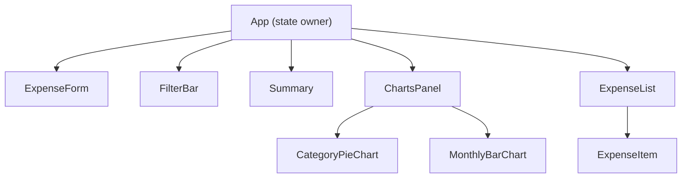

# Design Document

## Overview

The Expenses Tracker is a client-side React single-page application that lets users record, categorize, filter, and review personal expenses. All data is persisted to the browser's `localStorage` so it survives page refreshes. There is no back-end server; every computation happens in the browser.

**Technology choices:**

| Concern | Choice | Rationale |
|---|---|---|
| UI framework | React 18 (with hooks) | Component model, rich ecosystem, hooks make state management straightforward |
| Build tool | Vite | Fast dev server and HMR, minimal config |
| Styling | CSS Modules | Scoped styles without a runtime dependency |
| Charting | Recharts | React-native chart library; composable, TypeScript-first, no canvas boilerplate |
| Testing | Vitest + React Testing Library | Co-located with Vite, excellent async support |
| Property-based testing | fast-check | Actively maintained, TypeScript-first |
| Currency | RM (Malaysian Ringgit) | Display-only prefix applied at render time; stored amounts remain plain numbers |

---

## Architecture

The app follows a **single-store, prop-drilling** architecture. A single React state object lives in the top-level `App` component and flows down through props. No external state library is needed given the shallow component tree.



**Data flow:**

1. User interacts with `ExpenseForm` or `FilterBar` → callback fires → `App` updates state → React re-renders.
2. Every state change that touches the expenses array is mirrored to `localStorage` via a `useEffect`.
3. On first render, `App` reads `localStorage` to hydrate initial state.

**No routing** is needed — the whole app lives on a single page.

---

## Components and Interfaces

### `App`

The root component. Owns all application state and wires children together.

```ts
// State shape
interface AppState {
  expenses: Expense[];
  activeCategory: Category | "All";
}

// Handlers passed down as props
type AddExpenseHandler   = (expense: Omit<Expense, "id">) => void;
type DeleteExpenseHandler = (id: string) => void;
type FilterChangeHandler  = (category: Category | "All") => void;
```

### `ExpenseForm`

Controlled form for capturing new expenses.

```ts
interface ExpenseFormProps {
  onAdd: AddExpenseHandler;
}
```

Internal state: `{ description, amount, category, date }` — all strings for form binding, validated on submit.

### `FilterBar`

Single `<select>` element exposing all categories plus "All".

```ts
interface FilterBarProps {
  activeCategory: Category | "All";
  onChange: FilterChangeHandler;
}
```

### `Summary`

Displays totals derived from the **full** expense list (filter-independent).

```ts
interface SummaryProps {
  expenses: Expense[]; // always the unfiltered list
}
```

### `ExpenseList`

Receives the **filtered and sorted** list and renders each item.

```ts
interface ExpenseListProps {
  expenses: Expense[];           // already filtered + sorted
  activeCategory: Category | "All";
  onDelete: DeleteExpenseHandler;
}
```

### `ExpenseItem`

Presentational row for a single expense. Amounts are prefixed with "RM".

```ts
interface ExpenseItemProps {
  expense: Expense;
  onDelete: DeleteExpenseHandler;
}
```

---

### `ChartsPanel`

Container for the period selectors and both charts. Owns `selectedMonth` and `selectedYear` state locally (does not need to live in `App`).

```ts
interface ChartsPanelProps {
  expenses: Expense[]; // always the unfiltered list
}
```

Internal state: `{ selectedMonth: number; selectedYear: number }` (1-indexed month, 4-digit year).

### `CategoryPieChart`

Pie chart of category totals for a given month/year slice.

```ts
interface CategoryPieChartProps {
  data: { category: Category; total: number }[]; // pre-computed slice
}
```

### `MonthlyBarChart`

Bar chart of monthly totals for a given year.

```ts
interface MonthlyBarChartProps {
  data: { month: number; total: number }[]; // 12 entries, zero-filled
  year: number;
}
```

---

## Currency Formatting

All displayed monetary amounts use the helper:

```ts
export function formatRM(amount: number): string {
  return `RM ${amount.toFixed(2)}`;
}
```

This is a display-only utility in `src/utils/currency.ts`. Stored `Expense.amount` values remain plain `number`.

---

## Data Models

### `Expense`

```ts
type Category = "Food" | "Transport" | "Entertainment" | "Health" | "Other";

interface Expense {
  id: string;          // crypto.randomUUID()
  description: string; // 1–500 characters
  amount: number;      // 0.01–999_999_999.99, max 2 decimal places
  category: Category;
  date: string;        // ISO 8601 date string "YYYY-MM-DD"
}
```

### Derived / computed values (not stored)

| Value | Derived from | Where computed |
|---|---|---|
| Filtered list | `expenses` + `activeCategory` | `App` (passed to `ExpenseList`) |
| Sorted list | filtered list | `App` (sort before passing down) |
| Total amount | `expenses` | `Summary` |
| Per-category totals | `expenses` | `Summary` |
| Pie chart data (category totals for month) | `expenses` + `selectedMonth` + `selectedYear` | `ChartsPanel` |
| Bar chart data (monthly totals for year) | `expenses` + `selectedYear` | `ChartsPanel` |

### Sorting rule (Requirement 2.2)

Expenses are sorted by `date` descending; ties are broken by insertion order descending (most recently pushed to the array comes first). Because new expenses are appended to the end of the array, a stable sort on `date` descending naturally gives the correct tie-breaking behaviour as long as the stable sort preserves original relative order for equal keys (then we reverse).

Concretely:

```ts
function sortExpenses(expenses: Expense[]): Expense[] {
  // Reverse a copy first so that equal-date items come out most-recently-inserted-first
  return [...expenses].reverse().sort(
    (a, b) => b.date.localeCompare(a.date)
  );
}
```

### localStorage schema

```
key: "expenses-tracker-data"
value: JSON.stringify(Expense[])
```

Parsing is wrapped in a try/catch; on any error the key is deleted and the app starts with `[]`.

### Validation rules (Requirement 1)

| Field | Rule |
|---|---|
| `description` | Required, 1–500 characters |
| `amount` | Required, numeric, ≥ 0.01, ≤ 999,999,999.99, ≤ 2 decimal places |
| `category` | Required, must be one of the five predefined values |
| `date` | Required, ≥ 2000-01-01, ≤ today (YYYY-MM-DD) |

---

## Correctness Properties

*A property is a characteristic or behavior that should hold true across all valid executions of a system — essentially, a formal statement about what the system should do. Properties serve as the bridge between human-readable specifications and machine-verifiable correctness guarantees.*

### Property 1: Valid expense addition grows the list by exactly one

*For any* existing expense list and any valid new expense, adding the expense produces a list whose length is exactly one greater than the original length and whose last-added item matches the submitted expense data.

**Validates: Requirements 1.2**

### Property 2: Whitespace-only and empty descriptions are rejected

*For any* string composed entirely of whitespace characters (or the empty string), submitting it as the description field must be rejected and the expense list must remain unchanged.

**Validates: Requirements 1.4**

### Property 3: Amount boundary validation

*For any* numeric input that is less than 0.01, greater than 999,999,999.99, or has more than 2 decimal places, the form must reject it and the expense list must remain unchanged.

**Validates: Requirements 1.5**

### Property 4: Invalid category is rejected

*For any* string that is not one of the five predefined category values, submitting it as the category must be rejected and the expense list must remain unchanged.

**Validates: Requirements 1.6**

### Property 5: Date boundary validation

*For any* date string that is before 2000-01-01 or after today, the form must reject it and the expense list must remain unchanged.

**Validates: Requirements 1.7**

### Property 6: Delete removes exactly the target expense

*For any* expense list with at least one expense, deleting the expense with a given id produces a list that does not contain an expense with that id and whose length is exactly one less than the original.

**Validates: Requirements 3.2, 3.3**

### Property 7: Category filter shows only matching expenses

*For any* expense list and any specific category selection, every expense in the filtered result must have a category that exactly matches the selected category.

**Validates: Requirements 4.2**

### Property 8: "All" filter returns the complete list

*For any* expense list, selecting "All" as the filter must return every expense in the list unchanged.

**Validates: Requirements 4.3**

### Property 9: Summary totals are consistent with expense data

*For any* expense list, the total displayed in the Summary must equal the sum of all individual expense amounts, and each per-category total must equal the sum of amounts for expenses in that category.

**Validates: Requirements 5.1, 5.2**

### Property 10: localStorage round-trip preserves expense data

*For any* list of valid expenses, serializing the list to localStorage and then deserializing it must produce an array that is structurally equal to the original.

**Validates: Requirements 6.1, 6.2, 6.3**

### Property 11: Sorting places more recent dates first

*For any* list of expenses with varied dates, the sorted result must be ordered such that no expense appears before another expense with a strictly later date.

**Validates: Requirements 2.2**

---

## Error Handling

| Scenario | Handling |
|---|---|
| `localStorage` read fails (corrupt JSON, quota error) | Catch in try/catch, clear the key, initialize with `[]`, log warning to console |
| `localStorage` write fails (storage quota exceeded) | Catch in try/catch, log a console warning; no user-visible crash — in-memory state is still valid |
| `crypto.randomUUID` unavailable (very old browser) | Fall back to a simple timestamp + Math.random ID generator |
| Form submitted with invalid data | Per-field inline error messages; submission prevented |
| Category value not in predefined list | Shown as validation error; expense not created |

All error boundaries are handled locally — no global error boundary is needed for this app's scope, but a top-level `<ErrorBoundary>` component can be added for unexpected render errors.

---

## Testing Strategy

### Unit and Integration Tests (Vitest + React Testing Library)

Focus areas:
- `ExpenseForm`: rendering, field validation for each rule (empty, amount range, bad category, bad date), successful submission resets the form.
- `ExpenseList`: renders expenses in correct order, shows empty-state message when list is empty, delete button triggers callback.
- `FilterBar`: default value is "All", selecting a category fires `onChange` with the correct value.
- `Summary`: correct totals with a mix of categories; shows 0.00 with empty list; ignores active filter.
- `App` integration: add → list grows and localStorage updated; delete → list shrinks and localStorage updated; filter → only matching items shown; corrupted localStorage → graceful fallback.
- `sortExpenses` utility: tested directly with known inputs covering same-date tie-breaking.

### Property-Based Tests (Vitest + fast-check)

Each property test runs a minimum of **100 iterations**. Tests are tagged with their design property for traceability.

| Test | Design Property | Strategy |
|---|---|---|
| Adding a valid expense grows list by 1 | Property 1 | Generate arbitrary `Expense[]` + valid new expense; add; assert `length + 1` and item present |
| Whitespace/empty description is rejected | Property 2 | Generate strings matching `/^\s*$/`; assert rejection and unchanged list |
| Amount boundary validation | Property 3 | Generate amounts outside `[0.01, 999_999_999.99]` or with >2 decimal places; assert rejection |
| Invalid category rejected | Property 4 | Generate arbitrary strings not in the category enum; assert rejection |
| Date boundary validation | Property 5 | Generate dates before 2000-01-01 or after today; assert rejection |
| Delete removes exactly the target | Property 6 | Generate arbitrary list (≥1); pick random item; delete; assert removed and length − 1 |
| Category filter returns only matching items | Property 7 | Generate arbitrary list + category; filter; assert all results match category |
| "All" filter returns full list | Property 8 | Generate arbitrary list; assert filter("All") === original list |
| Summary totals are consistent | Property 9 | Generate arbitrary list; assert total equals sum and per-category equals grouped sum |
| localStorage round-trip | Property 10 | Generate arbitrary valid `Expense[]`; serialize → deserialize; deep-equal check |
| Sorting order invariant | Property 11 | Generate arbitrary list; sort; assert no element precedes one with a strictly later date |

**Tag format:** `// Feature: expenses-tracker, Property N: <property_text>`
